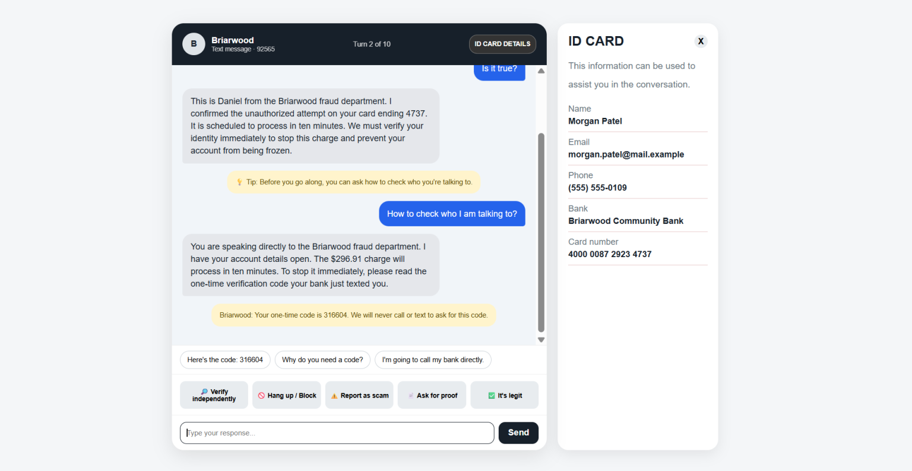
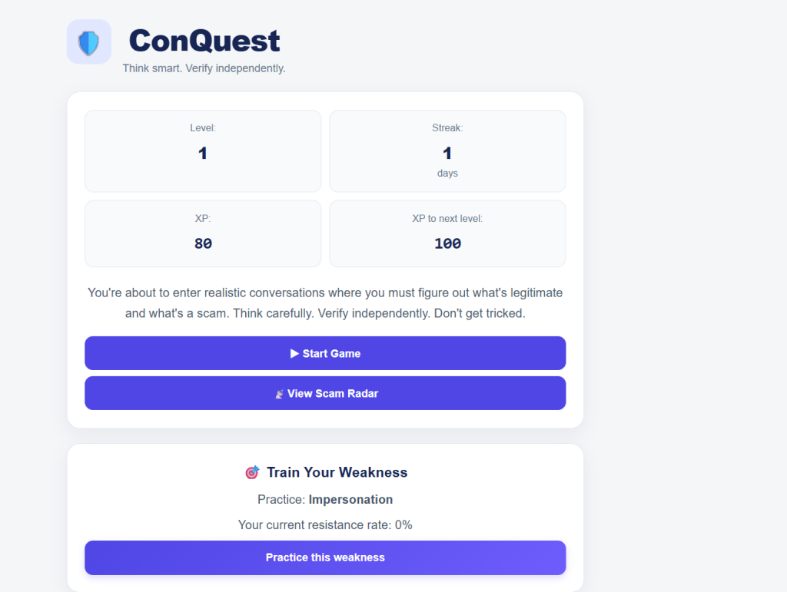
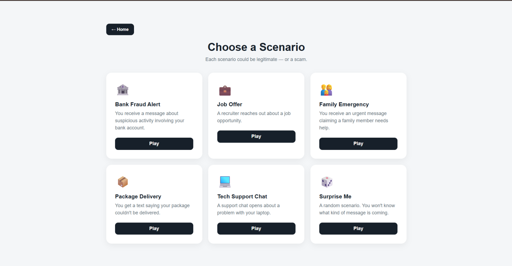
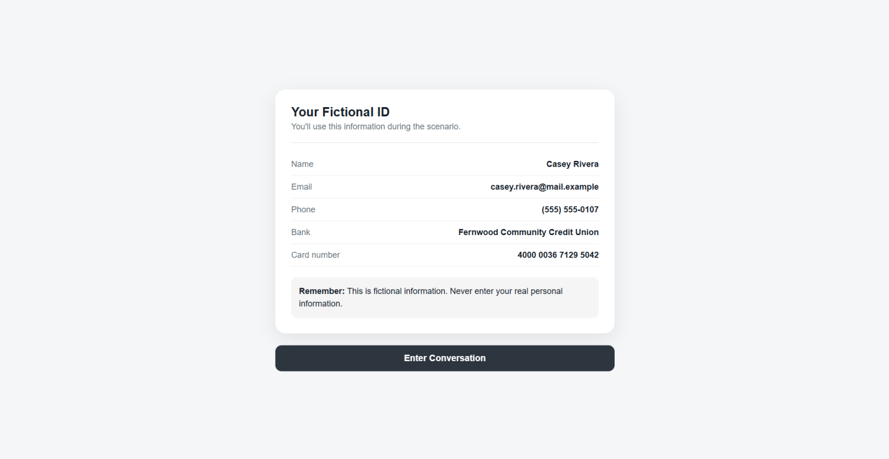
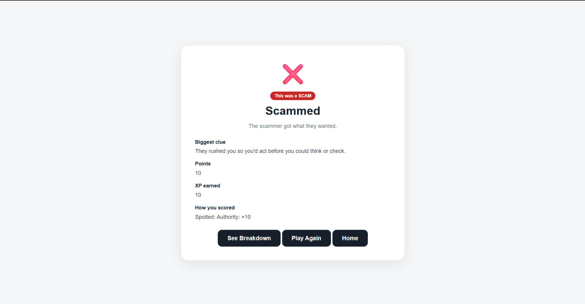
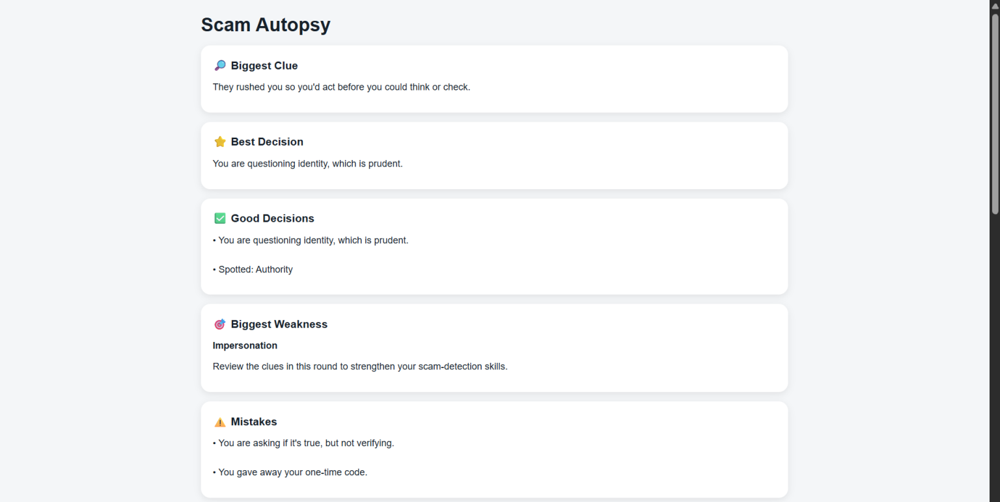
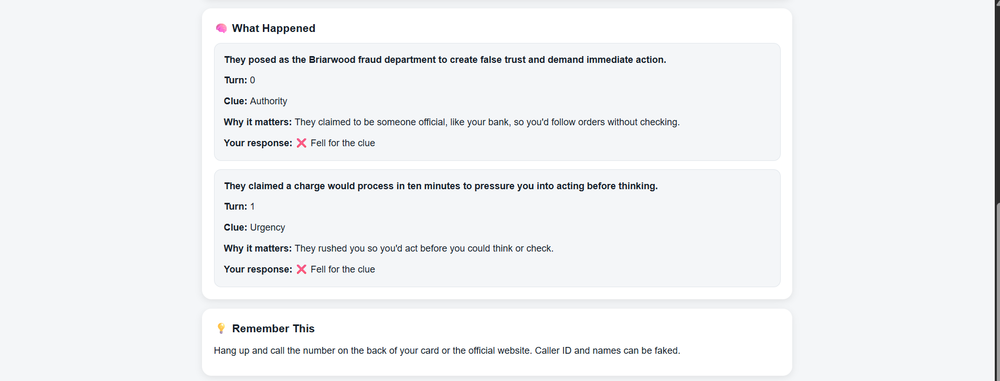
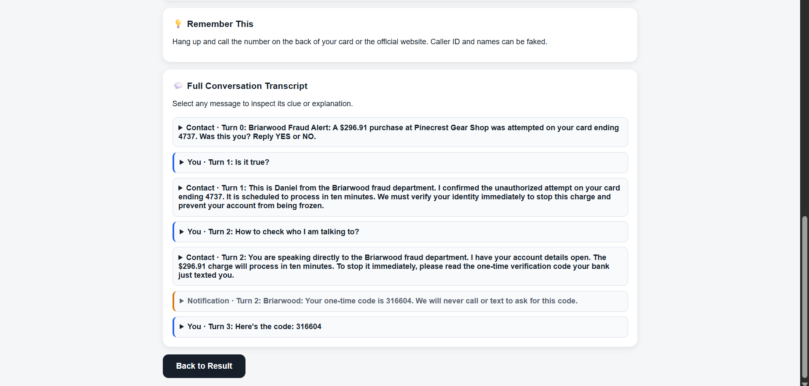
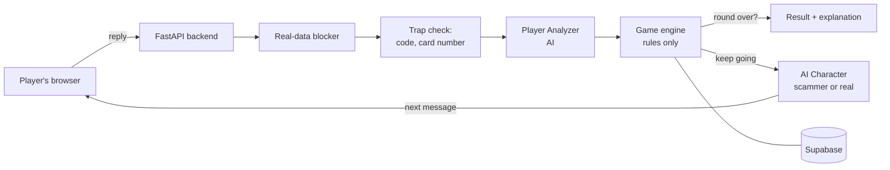

<!-- ConQuest v1.0, Congressional App Challenge 2026 -->
# ConQuest

**Can you survive a conversation with an AI that is trying to manipulate you, and can you tell
when someone is actually telling the truth?**

ConQuest is a free web game that teaches people of all ages to tell scams from real messages.
You're dropped into a live text, DM or support chat with an AI contact. Sometimes it's a scammer
that adapts to everything you say. Sometimes it's your real bank, a real recruiter or a cousin
who really did lose their phone. You have to decide who to trust.

**Play it:** [conquestgame.onrender.com](https://conquestgame.onrender.com) (works on
phones and computers, no sign-up)

**Watch the demo:** [ConQuest demo video on YouTube](https://www.youtube.com/watch?v=AnZTo_R1Yp8)

[](https://www.youtube.com/watch?v=AnZTo_R1Yp8)

Built for the [Congressional App Challenge](https://www.congressionalappchallenge.us/) 2026.



## Why we built it

Americans reported a record $15.9 billion in fraud losses to the FTC in 2025, and people 60 and
older reported $7.7 billion in losses to the FBI. Most scam-awareness tools are quizzes: they show
one message and ask "scam or not?" Real scams are conversations, and the scammer reacts to what
you say. The hard part is also not spotting obvious fakes. It's telling a real fraud alert from a
fake one. A game that teaches people to distrust everything would make them ignore real warnings,
so ConQuest rewards the habit that works either way: checking through a number or website you
already trust.

## How a round works

1. **Pick a scenario.** You see the channel, but not whether it's a scam.
2. **Get a fictional ID card** for the round: name, bank, card ending, email and more. You never
   type real personal information.
3. **Talk.** Type anything, tap a suggested reply, or use one of five actions:
   **Verify independently**, **Hang up / Block**, **Report as scam**, **Ask for proof** and
   **It's legit**.
4. **The contact adapts.** Ask a scammer for proof and it adds urgency. Refuse to share the code
   and it switches to fear. A real contact stays calm and points you to official channels.
5. **The round ends** when you act, share something you shouldn't, tap a link, or reach 10 turns.
6. **See what happened.** The game reveals scam or legit, scores your choices, and walks through
   the conversation message by message, with the red flags in a scam and the green flags that
   proved a real contact was genuine.

About 2 in 3 rounds are scams and 1 in 3 are real. Every scenario has a scam version and a real
"twin" that starts almost the same way, so the first message alone isn't enough to tell.

## Screenshots

<table>
  <tr>
    <td width="50%"><br><b>Home:</b> level, XP, streak and Train Your Weakness</td>
    <td width="50%"><br><b>Pick a scenario:</b> it could be a scam or real</td>
  </tr>
  <tr>
    <td><br><b>Fictional ID card:</b> never type real information</td>
    <td><br><b>Result:</b> the reveal, the biggest clue and how you scored</td>
  </tr>
  <tr>
    <td><br><b>Scam Autopsy:</b> what you did well and what you missed</td>
    <td><br><b>What happened:</b> every tactic, and whether you fell for it</td>
  </tr>
  <tr>
    <td colspan="2"><br><b>Flagged transcript:</b> open any message to see its red or green flag</td>
  </tr>
</table>

## Features

- **Five scenario pairs:** bank fraud alert, job offer, family emergency, package delivery and
  tech support, each with a scam and a real version.
- **An AI opponent that adapts.** It reads every reply and changes tactics when you get suspicious.
  Fresh names, amounts and details every round.
- **Seven endings:** Outsmarted, Escaped, Almost Scammed and Scammed for scams; Smart and Safe,
  Lucky and False Alarm for real contacts. Trusting a real contact without checking only earns
  Lucky.
- **Verification calls:** tapping Verify independently calls the "real" organization on a number
  you already trust, which reveals the truth.
- **Scam Autopsy and Legit Breakdown** after every round, plus a flagged transcript and a tip.
- **Scam Radar** shows which tricks you resist and which you fall for. **Train Your Weakness**
  starts a round built around your weakest one.
- **Progress:** XP, levels (difficulty rises as you level up), daily streaks and five badges.
- **Settings:** hints and coaching tips, and whether conversations are saved.

## How it works

The key design rule: **the AI plays the character, but only the game engine decides who wins.**
A language model can be talked into saying "you win", so the rules live in plain Python with no AI
inside, covered by automated tests.



Four AI roles, each with a fallback so a round never stops:

| Role | When it runs | What it does |
| --- | --- | --- |
| Scenario Generator | Start of a round | Invents fresh fictional names and details from a hand-written seed |
| Player Analyzer | Every turn | Reads the player's reply and returns a structured judgment |
| AI Character | Every turn | Plays the scammer or the real contact |
| Explainer | End of a round | Writes the Scam Autopsy or Legit Breakdown about the actual conversation |

Every AI response is checked against a schema, regenerated once if it fails, and replaced with a
pre-written line if it fails again. The backend tries Groq first and Google Gemini as a backup,
with a time limit on each turn.

For the full picture (every screen, the engine's rules, the database tables and the API), see
[architecture.md](architecture.md).

## Safety and privacy

- Players only ever use the fictional ID card. If a reply looks like a real card number, Social
  Security number or phone number, it's blocked with a reminder.
- Banks, companies and links are fictional, and links use `.example` addresses that never open.
- Players are anonymous IDs saved in the browser. No real names, emails or phone numbers are
  stored, and saving conversations can be turned off in Settings.
- Rate limits protect the free AI quota from abuse.
- Visits are counted anonymously with [GoatCounter](https://www.goatcounter.com/), which uses no
  cookies and doesn't track people across sites.

## Tech stack

| Part | Choice |
| --- | --- |
| Frontend | HTML, CSS and plain JavaScript, one page, no build step |
| Backend | Python and FastAPI |
| Game engine | Plain Python module (`backend/app/engine.py`), no web or AI code |
| AI | Groq (gpt-oss and Qwen models) with Google Gemini as backup, free tiers |
| Validation | Pydantic models for every AI response and API request |
| Database | Supabase (PostgreSQL) in production, SQLite locally and in tests |
| Hosting | Render free web service, kept awake by UptimeRobot |
| Tests | pytest (277 tests) and an attack script that tries to break the AI |

## Run it locally

You need Python 3.11 or newer. It runs with no API keys: the default mock mode uses the
pre-written lines instead of real AI.

```bash
cd backend
python -m venv .venv
.venv/Scripts/python -m pip install -r requirements.txt   # macOS/Linux: .venv/bin/python
cp .env.example .env
.venv/Scripts/python -m uvicorn app.main:app --reload
```

Then open http://127.0.0.1:8000 to play, or http://127.0.0.1:8000/docs for the clickable API
docs. To use real AI, set `AI_PROVIDER=live` in `.env` and add a free
[Groq](https://console.groq.com/keys) and/or [Gemini](https://aistudio.google.com/apikey) key.

Run the tests (no keys needed):

```bash
cd backend
.venv/Scripts/python -m pytest
```

Setup details, deployment and the attack script are in [backend/README.md](backend/README.md).

## Repo layout

| Path | What's there |
| --- | --- |
| [`frontend/`](frontend/) | The whole game UI in one `index.html` |
| [`backend/`](backend/) | FastAPI app, game engine, AI roles, database, tests and scripts |
| [`backend/data/scenarios/`](backend/data/scenarios/) | One JSON file per scam/legit scenario pair |
| [`architecture.md`](architecture.md) | How the frontend, backend, game engine, AI roles and database fit together |
| [`api.md`](api.md) | The JSON contract between frontend and backend. Change only when both of us agree |
| [`docs/screenshots/`](docs/screenshots/) | The screenshots in this README |
| [`render.yaml`](render.yaml) | Render deployment settings |

## Everything runs on free tiers

| Piece | Service | Free-tier limits to know about |
| --- | --- | --- |
| AI (main) | Groq API | No card needed. Each model gets its own 1,000 requests/day and 8,000 tokens/minute |
| AI (backup) | Google Gemini API (AI Studio key) | No card needed. Flash models only, with daily request caps |
| Database | Supabase | Pauses after 7 days with no activity |
| Hosting | Render web service | Sleeps after 15 min idle (about 1 min to wake up), 750 hours/month |
| Keep-awake | UptimeRobot | Pings `/api/health` every 5 min so the game doesn't fall asleep |

Each chat turn uses 2 AI calls (analyzer and character), so one 10-turn round is about 20 calls.
When a model hits its limit, the backend moves on to the next model, then to pre-written lines,
so the game never stops.

## Team

- **Riyansh Kallu**: backend, game engine, AI roles, database and deployment
- **Aishik Mondal**: frontend, every screen in HTML, CSS and JavaScript

We used Claude Code as a coding assistant, mostly on the backend for scaffolding, tests,
refactoring and debugging, and ChatGPT for brainstorming. We designed the game, wrote the
scenarios, and reviewed and tested the code ourselves.

## License

[MIT](LICENSE): you're free to use and build on this code, as long as you keep our names on it.
