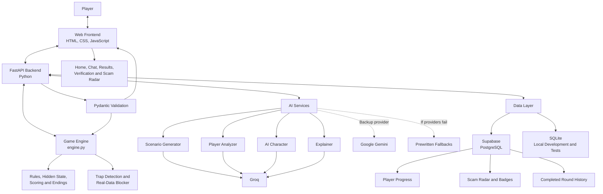

# ConQuest — System Architecture

## 1. Overview

ConQuest is an interactive scam-awareness web game that teaches players to recognize manipulation tactics, evaluate suspicious requests, and distinguish fraudulent messages from legitimate contacts.

Unlike a traditional scam quiz, ConQuest places players inside an adaptive conversation. An AI character responds to the player's decisions, changes tactics when challenged, and behaves differently depending on whether the contact is fraudulent or legitimate.

The system is built around one important principle: **AI controls the conversation, but the rule-based game engine controls the outcome.** This separation keeps scoring, endings, and safety checks consistent even when AI-generated conversations vary.

## 2. Architecture Diagram

The diagram shows the logical architecture. The frontend communicates with the backend API, which coordinates the game engine, AI services, validation, and database operations.

## 3. Frontend

The frontend is a single-page web application built with HTML, CSS, and plain JavaScript. It requires no frontend build step and is designed to work on phones and computers.

The frontend is responsible for displaying the game and collecting player actions. Its screens include:

- **Onboarding:** Three short cards explaining the game, shown on a player's first visit.
- **Home:** Player level, XP, streak, the Train Your Weakness card, and Scam Radar access.
- **Scenario Selection:** The five scenarios plus a random "Surprise Me" option.
- **ID Card:** Fictional identity details used during the current round.
- **Chat:** Conversation messages, suggested replies, free-text input, and action buttons.
- **Verification Call:** A scripted verification interaction that reveals whether the contact is legitimate.
- **Simulated Website:** A clearly fake page shown when a player taps a link in the conversation.
- **Results:** The ending, points, XP, and the reveal of whether the contact was a scam or legitimate.
- **Scam Autopsy and Legit Breakdown:** Explanations of tactics, clues, mistakes, and good decisions.
- **Flagged Transcript:** Message-level red and green flags with explanations.
- **Scam Radar:** Tactic-recognition statistics and earned badges.
- **Settings:** Controls for hints, saving conversations, and resetting progress.

The frontend sends requests to the API and renders the returned data. It does not independently decide whether a player wins or loses.

## 4. Backend and Game Engine

The backend uses Python and FastAPI to expose HTTP endpoints, coordinate services, validate requests, and return structured JSON responses.

The game engine is implemented separately in `engine.py`, keeping core rules independent of web requests and AI calls.

Its responsibilities include:

- Assigning scam or legitimate scenarios.
- Tracking the hidden state of each round.
- Checking player messages for target information and unsafe real personal data.
- Updating suspicion, trust, risk, recognized tactics, and mistakes.
- Applying scoring, XP, progression, and ending rules.
- Enforcing the turn limit and other round-ending conditions.
- Updating the information used by explanations and Scam Radar.

The game supports five scenario categories: bank fraud alerts, job offers, family emergencies, package deliveries, and tech support. Each category has a scam version and a legitimate counterpart.

There are seven possible endings: OUTSMARTED, ESCAPED, ALMOST SCAMMED, SCAMMED, SMART AND SAFE, LUCKY, and FALSE ALARM.

## 5. Artificial Intelligence Architecture

ConQuest uses four AI roles. Each has a specific responsibility, and its output is validated before being used by the application.

### Scenario Generator

Creates a fresh variation from a hand-written scenario seed. It can vary fictional names, organizations, amounts, wording, and the tactics introduced during a round.

If generation fails or takes too long, the game can use the original seed scenario instead.

### Player Analyzer

Evaluates the player's latest response in the context of the conversation. It returns structured information such as the decision type, changes to suspicion and trust, information shared, recognized tactics, and whether a mistake occurred.

The backend validates this output before applying the permitted changes to game state.

### AI Character

Generates the contact's next message based on the scenario and current game state.

In scam mode, the character attempts manipulation and can switch tactics when the player challenges it. In legitimate mode, the contact behaves consistently with a real organization or person, accepts independent verification, and does not request passwords, verification codes, or unusual payments.

### Explainer

Runs after the round and generates the Scam Autopsy or Legit Breakdown using the conversation, detected flags, and analyzer information.

It explains what happened, while the game engine supplies authoritative outcomes such as the ending and score.

### Provider fallback

The backend attempts to use Groq first, Google Gemini as a backup, and prewritten responses if the AI providers fail. This design reduces dependence on a single provider and helps prevent an unavailable model from stopping a round.

## 6. Validation and Reliability

AI responses are not trusted as unrestricted text or game instructions.

ConQuest uses Pydantic models to validate AI outputs and API data structures. Invalid AI responses can be retried or replaced with fallback content, according to the relevant validation and recovery logic.

Additional safeguards include:

- Checking messages for fictional trap items, such as verification codes and passwords.
- Blocking patterns that match real personal information.
- Limiting character responses to permitted tactics and message lengths.
- Enforcing game-ending conditions in backend code.
- Using scripted verification-call content rather than asking the AI to determine the truth.
- Keeping the scam-or-legitimate result hidden from the player until the round ends.

These controls help make the game's educational outcomes more predictable than a system that lets an AI model decide the result.

## 7. Database and Persistence

ConQuest uses Supabase with PostgreSQL for persistent data. SQLite is used for local development and testing.

The database contains six tables:

| Table | Purpose |
|---|---|
| `players` | Anonymous player identifiers, display names, levels, XP, streaks, and settings |
| `rounds` | Scenario information, difficulty, ending, points, turn count, and round timestamps |
| `messages` | Conversation messages, sender, detected tactic or flag, and analyzer data |
| `radar` | Tactic encounters and successful resistance counts |
| `round_ai` | How many AI answers in each round came from a live model or from the prewritten fallbacks |
| `live_rounds` | Rounds in progress, so a server restart or redeploy doesn't end them |

The database supports persistent player progress, Scam Radar statistics, and completed-round history.

The project is designed to use anonymous player identifiers rather than requiring players to register with their real names or email addresses.

## 8. API Communication

The frontend and backend communicate through JSON-based HTTP endpoints.

The main API operations include:

| Endpoint | Purpose |
|---|---|
| `POST /api/player` | Creates a player profile |
| `GET /api/scenarios` | Retrieves scenario options and the Train Your Weakness selection |
| `POST /api/round/start` | Starts a round and returns the fictional ID card and opening message |
| `POST /api/round/{round_id}/message` | Processes a player message and returns the character's response or a game-state update |
| `POST /api/round/{round_id}/action` | Processes actions such as verification, reporting, or hanging up |
| `GET /api/round/{round_id}/result` | Retrieves the ending, score, explanations, flagged transcript, and tip |
| `GET /api/player/{player_id}/radar` | Retrieves player progression, Scam Radar statistics, and badges |

Additional endpoints support player settings and resetting progress.

The API contract is documented in `api.md`. The backend also provides interactive API documentation through FastAPI's `/docs` endpoint.

## 9. Hosting and Deployment

The backend is deployed on Render, where FastAPI serves the API and frontend files. This provides a single public application address for players and judges.

The application uses environment-based configuration for external service credentials rather than placing secret API keys in frontend code.

The intended deployment supports a browser-based experience without requiring users to install a separate application.

## 10. Testing

ConQuest uses multiple testing approaches because AI-driven conversations can vary between runs.

- **Automated tests:** pytest tests for the game engine, validation, scoring, endings, and other backend behavior.
- **AI attack testing:** A dedicated script tests adversarial and unexpected inputs to identify failures in AI behavior and validation.
- **Interactive testing:** The `/play` page allows complete rounds to be exercised through the backend.
- **Manual testing:** Browser testing checks screen transitions, API integration, and the gameplay experience.

The automated tests and our own play sessions serve different purposes: automated tests check repeatable rules, while playing the game ourselves reveals usability problems and whether the lessons come across clearly.

## 11. Technology Stack

| Component | Technology |
|---|---|
| Frontend | HTML, CSS, JavaScript |
| Backend API | Python, FastAPI |
| Game engine | Python |
| AI providers | Groq, Google Gemini fallback |
| AI output validation | Pydantic |
| Database | Supabase, PostgreSQL |
| Local development and tests | SQLite |
| Hosting | Render |
| Automated testing | pytest |
| API documentation | FastAPI `/docs` |
| Source control | Git and GitHub |

## 12. Design Principles

ConQuest follows four core design principles:

1. **Deterministic outcomes:** AI generates dialogue and explanations, but backend rules control scoring and endings.
2. **Verification over guessing:** Independent verification is the safest decision whether the contact is fraudulent or legitimate.
3. **Safety by design:** Fictional identities, real-data blocking, constrained AI outputs, and fallback responses reduce risks during gameplay.
4. **Learning through feedback:** The Scam Autopsy, Legit Breakdown, flagged transcript, and Scam Radar help players understand their decisions and improve over time.

The architecture separates the user interface, game rules, AI behavior, validation, and persistence so each part can be tested and improved independently.

